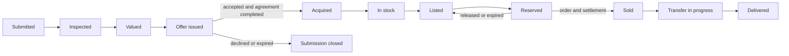
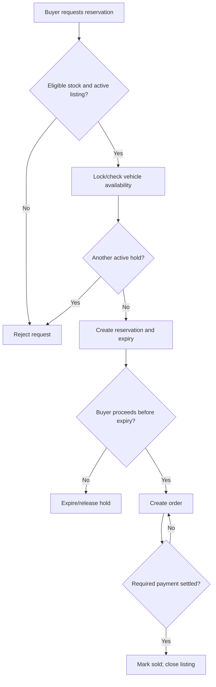

# Business Process Workflows

All workflows describe an educational independent-marketplace scenario, not confirmed CARS24 internal procedure. Timestamps are UTC instants; staff use local city time for scheduling.

## 1. Customer registration
**Start:** person requests an account. **Actors:** customer, support. **Steps:** capture minimum identity/contact → verify contact outside this data model → add dated address/contact → activate customer. **Data/entities:** Customer, CustomerContact, CustomerAddress. **Validations:** stable customer key; normalized phone/email uniqueness only where verified and policy permits; at least one reachable contact for active account. **Failures:** duplicate verified contact, invalid details, verification timeout. **Outcome:** one customer record usable in buyer and seller roles.

## 2. Vehicle submission
**Start:** customer submits a vehicle. **Actors:** seller, support. **Steps:** identify vehicle/catalog attributes and registration → record current owner → create submission → schedule inspection. **Data/entities:** Customer, Vehicle, VehicleRegistration, VehicleOwnershipHistory, VehicleSubmission, Inspection. **Validations:** submitter must be current owner or documented authorized representative; registration identity checked; vehicle cannot already be sold/actively acquired. **Failures:** ownership mismatch, duplicate vehicle, incomplete evidence. **Outcome:** submission pending assessment or rejected with reason.

## 3. Vehicle inspection
**Start:** inspection appointment accepted. **Actors:** inspector, seller. **Steps:** create scheduled Inspection → record checklist InspectionItems and Defects → finalize InspectionReport with outcome → retain report. **Entities:** Vehicle, VehicleSubmission, Employee, Inspection, InspectionReport, InspectionItem, Defect. **Validations:** assigned inspector active; one final report per inspection; finalized findings immutable by correction/revision record policy. **Failures:** no-show, incomplete checks, vehicle identity mismatch. **Outcome:** report pass/conditional/fail; repeat inspections remain history.

## 4. Vehicle valuation
**Start:** sufficient assessment data exists. **Actors:** valuation team. **Steps:** assess condition/market inputs → record dated valuation → review → use valuation to prepare offer. **Entities:** Vehicle, InspectionReport, Employee, VehicleValuation. **Validations:** amount nonnegative, currency specified, valuation date and assessor required; valuation is a snapshot, not overwritten. **Failures:** missing inspection, stale data, review rejection. **Outcome:** usable valuation or reassessment request.

## 5. Vehicle acquisition
**Start:** seller accepts a live offer. **Actors:** seller, sales/operations, finance. **Steps:** verify offer and seller authority → execute PurchaseAgreement → complete handover/payment → record VehicleAcquisition → update ownership history from seller to company → create inventory position. **Entities:** PurchaseOffer, PurchaseAgreement, VehicleAcquisition, Vehicle, Customer, VehicleOwnershipHistory, Inventory. **Validations:** accepted unexpired offer; one completed acquisition per vehicle per acquisition event; agreement, parties, amount and date required; current owner matches seller. **Failures:** offer expired, title discrepancy, seller withdraws, payment/handover incomplete. **Outcome:** acquired vehicle enters company custody; otherwise offer remains incomplete/cancelled.

## 6. Inventory management
**Start:** vehicle enters custody or changes location. **Actors:** inventory manager, branch manager. **Steps:** place vehicle at location → append InventoryMovement for each receipt, transfer, hold or dispatch → derive current position from latest valid movement. **Entities:** Inventory, Branch, InventoryMovement, Vehicle. **Validations:** source location matches current position; movement has actor/time/reason; vehicle not sold or dispatched as available. **Failures:** location mismatch, duplicate receipt, unresolved hold. **Outcome:** auditable current custody and availability.

## 7. Vehicle listing
**Start:** eligible acquired stock is ready. **Actors:** inventory manager, sales executive. **Steps:** verify ownership/custody and current passing inspection → create listing → publish with price/details/media references → pause/withdraw when unavailable. **Entities:** Vehicle, Inventory, InspectionReport, VehicleListing, ListingImage. **Validations:** acquired, in stock, approved inspection, no active reservation/sale; one active listing per vehicle. **Failures:** missing evidence, stale inspection, hold, duplicate active listing. **Outcome:** active marketplace offer or documented nonpublication.

## 8. Buyer enquiry
**Start:** buyer asks about listing. **Actors:** buyer, sales/support. **Steps:** identify active listing and buyer → record channel/message reference and time → assign/follow up → close outcome. **Entities:** Customer, VehicleListing, CustomerEnquiry, Employee. **Validations:** listing/customer exist; enquiries remain even if listing later closes. **Failures:** listing unavailable, contact invalid. **Outcome:** tracked enquiry, possibly reservation intent.

## 9. Vehicle reservation
**Start:** buyer requests hold. **Actors:** buyer, sales executive. **Steps:** transactionally check eligible listing/inventory → create reservation with expiry → optionally capture deposit by policy → confirm, expire, release or convert to order. **Entities:** VehicleReservation, Customer, VehicleListing, Vehicle, SalesOrder, Payment. **Validations:** at most one active reservation per vehicle; expiry in future; reservation status and vehicle status updated atomically. **Failures:** concurrent winner, payment failure if deposit required, expiry. **Outcome:** exclusive temporary hold or rejection.

## 10. Sales and order
**Start:** reservation confirmed and buyer proceeds. **Actors:** buyer, sales, finance. **Steps:** validate reservation → create SalesOrder and one SalesOrderItem → confirm price/currency → take payment → mark sale complete only after required settlement and handover conditions. **Entities:** VehicleReservation, SalesOrder, SalesOrderItem, Vehicle, Customer, Payment. **Validations:** order item vehicle equals reservation vehicle; no other completed order; no active conflicting order; state transitions are controlled. **Failures:** reservation expired, payment declined, cancellation, concurrency conflict. **Outcome:** completed or cancelled order with immutable history.

## 11. Payment and refund
**Start:** order amount due or refund approved. **Actors:** buyer, finance, payment provider. **Steps:** record payment attempt/provider reference → reconcile outcome → on eligible cancellation/overpayment record refund against captured payment → reconcile refund outcome. **Entities:** SalesOrder, Payment, Refund. **Validations:** payment references order; currency matches; successful cumulative refunds cannot exceed successful captured payment; idempotent provider reference. **Failures:** decline, timeout/unknown status, duplicate callback, refund rejected. **Outcome:** reconciled financial event trail.

## 12. Ownership transfer
**Start:** sale is eligible for title transfer. **Actors:** sales, buyer, transfer coordinator. **Steps:** verify seller-to-company acquisition chain → submit transfer → record authority/reference and status → confirm new registered owner after evidence. **Entities:** SalesOrder, Vehicle, Customer, VehicleOwnershipHistory, OwnershipTransfer, VehicleRegistration. **Validations:** order vehicle matches; transfer parties align to ownership chain; completion requires evidence/date. **Failures:** authority rejection, missing documents, mismatch. **Outcome:** transfer completed or tracked exception; company-to-buyer ownership history is effective-dated.

## 13. Vehicle delivery
**Start:** order ready for handover. **Actors:** delivery team, buyer. **Steps:** schedule branch/address and recipient → dispatch vehicle → capture checklist/acknowledgement → record completion or failed attempt. **Entities:** SalesOrder, VehicleDelivery, Customer, Branch, InventoryMovement. **Validations:** order not cancelled; vehicle matches; delivery outcome and time required for completion. **Failures:** buyer unavailable, vehicle condition dispute, transport delay. **Outcome:** completed handover or rescheduled/exception status.

## Lifecycle and status transitions

Vehicle lifecycle is tracked through related domain records and a controlled current status on Vehicle (or an equivalent event log). Suggested states: **SUBMITTED → UNDER_INSPECTION → VALUED → OFFERED → ACQUIRED → IN_STOCK → LISTED → RESERVED → SOLD → DELIVERED**. Side paths include SUBMISSION_REJECTED, OFFER_DECLINED/EXPIRED, ACQUISITION_CANCELLED, LISTING_WITHDRAWN, RESERVATION_EXPIRED/RELEASED, ORDER_CANCELLED, and DELIVERY_EXCEPTION. Not every vehicle follows every optional state. Status changes must be authorized transitions with actor/time/reason and validated against related records. SOLD is terminal for sale availability; correction requires an explicit reversal/return/reacquisition event with evidence, never SOLD → AVAILABLE. Reservation expiry is a separate reservation transition and must atomically release the hold before availability resumes.

## Cross-workflow data lineage

Customer links seller submission/acquisition and buyer enquiry/reservation/order. Vehicle links catalog, inspections, valuation, acquisition, inventory movements, listing, order item, transfer and delivery. Financial events remain linked to order and payment; history is appended rather than overwritten.
