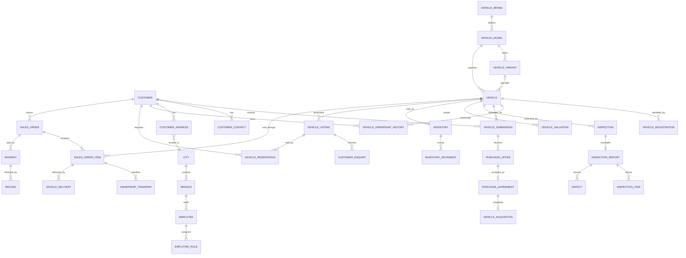

# Conceptual Data Model

## Business concepts and flow

The model treats a **Customer** as a person and seller/buyer as transaction roles. A **Vehicle** has a stable identity separate from changing registration, ownership, assessment, custody, and sale records. Reference catalog data describes make/model/variant. VehicleSubmission records an intake attempt; assessment records repeat; one accepted offer may lead to an executed agreement and acquisition. Inventory describes current position while InventoryMovement preserves location history. Listing and reservation are separate marketplace events. A SalesOrder has a buyer and vehicle detail; payments/refunds, transfer and delivery attach to that sale.

Typical trace: Customer A submits Vehicle X → several Inspections and Valuations → one PurchaseOffer and PurchaseAgreement → VehicleAcquisition records transfer from A → Inventory and InventoryMovements track custody → VehicleListing attracts Customer B's CustomerEnquiry → VehicleReservation temporarily holds stock → SalesOrder and SalesOrderItem commit one sale → Payments and Refunds reconcile money → OwnershipTransfer records title progress → VehicleDelivery records handover.

## Cardinality and optionality

- A customer may have zero or many contacts/addresses and may have zero or many submissions, enquiries, reservations, or orders. Each such record has exactly one relevant customer role.
- A brand has many models; a model belongs to one brand and may have many variants/vehicles. A vehicle uses one model and may optionally specify one variant.
- A vehicle has many registration, ownership, inspection, valuation, submission and movement records over time. Each history row belongs to exactly one vehicle. Current owner is represented by the latest effective ownership interval, not an independent competing source.
- An inspection belongs to one vehicle and optionally one submission; it has zero or one final report until finalized. A report has many checklist results and may have many defects.
- Valuations belong to one vehicle and may cite one inspection report. Offers belong to one submission, seller and valuation basis; agreement can be absent until accepted/executed. Acquisition is absent until completed and then references one agreement.
- Inventory has one current vehicle position; a vehicle has zero or one current inventory position. Inventory has many movement events. A completed acquisition normally precedes inventory, but intake can be represented before listing.
- A vehicle may have multiple historical listings, but at most one active listing by policy. A listing has many enquiries and historical reservations. Each enquiry/reservation has one customer.
- An order has one buyer and one or more items structurally; initial policy constrains it to one vehicle item. A vehicle may appear in many cancelled/attempted orders over time but at most one completed sale. Reservation may convert to at most one order.
- An order has many payment attempts; a payment can have many refund attempts. A sold order item may have zero or many transfer/delivery events (retries/administrative history); exactly one successful completion is a process condition, not simple cardinality.

## Conceptual ER diagram

Mermaid cardinality here is a conceptual overview. The logical ERD refines optional FKs and one-active-row policies. A status rule or temporal non-overlap rule cannot be expressed solely by the diagram.
